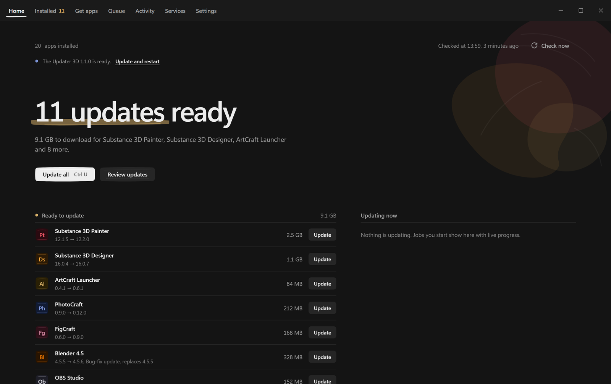
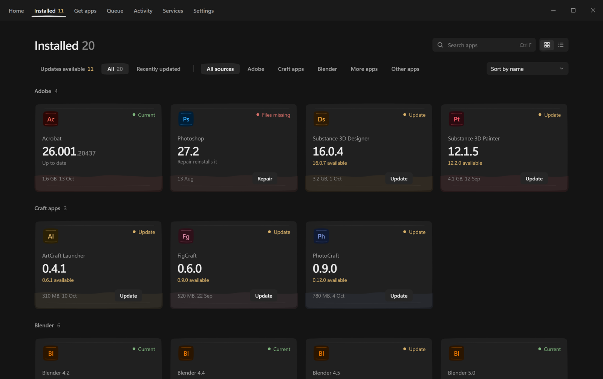
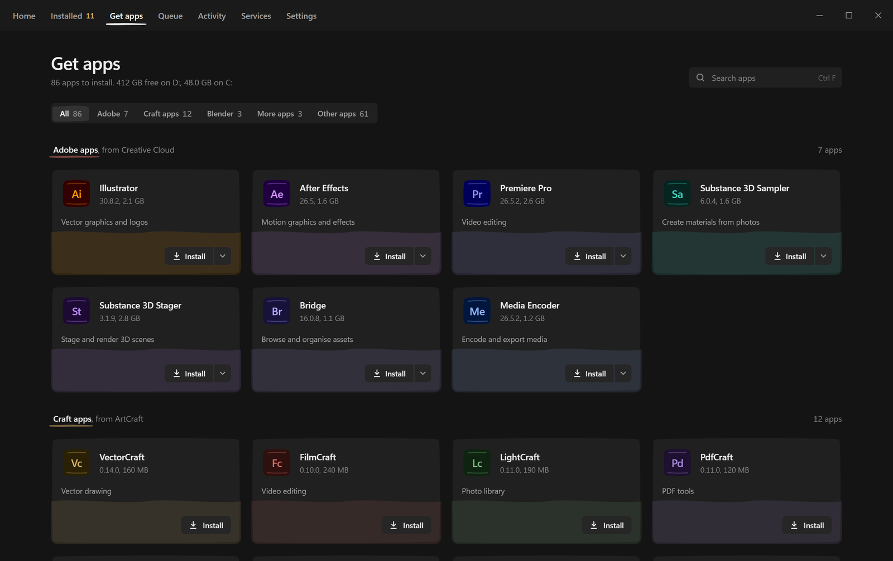
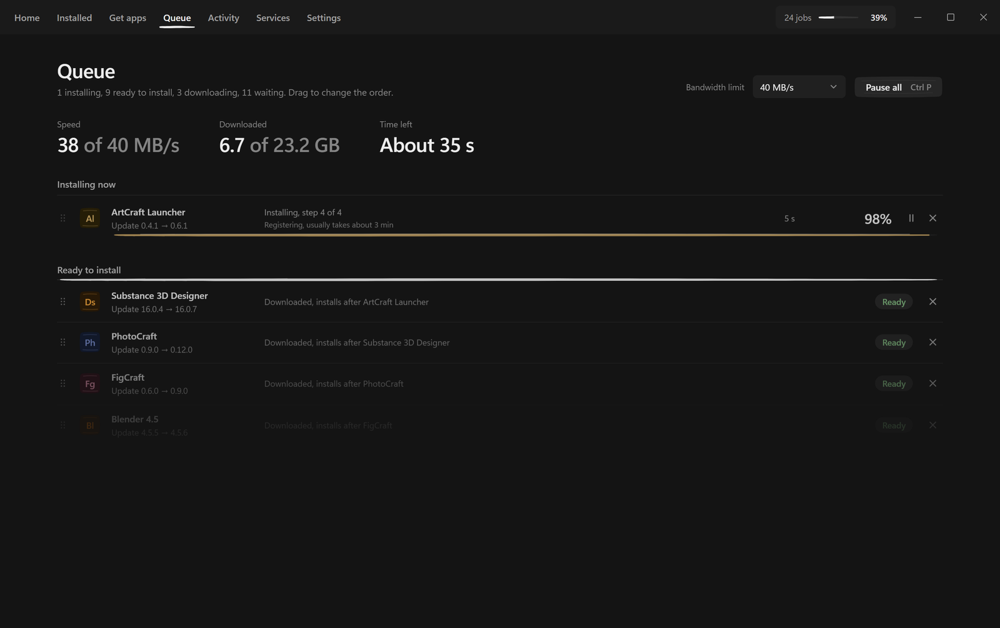

<div align="center">


# The Updater 3D

**Keep all your creative apps up to date from one place.**

Adobe Creative Cloud, Blender, the Craft apps, OBS, Krita, Unity and 15,000+ other Windows apps.
Finds what you have, shows what changed, and updates everything in one click.

[**Download for Windows**](https://github.com/CIoudGuy/the-updater-3d/releases/latest)
&nbsp;·&nbsp; [What's new](https://github.com/CIoudGuy/the-updater-3d/releases)
&nbsp;·&nbsp; [Report a bug](https://github.com/CIoudGuy/the-updater-3d/issues)



</div>

## Features

- **One list for everything.** Every installed app, its version, and whether an update is waiting.
- **Update all in one click.** Downloads run in parallel over several connections; installs run
  silently, one at a time, in the background.
- **Full change lists.** Release notes for every version, straight from each publisher.
- **Safe by default.** Every download is checked against the publisher's checksum or signature
  before anything runs. Nothing is installed that fails the check.
- **Picks up where it left off.** Pause, resume, lost connection or a restart: downloads continue
  instead of starting over.
- **Roll back or keep versions.** Install any older version, or keep Blender, Godot and Unity
  versions side by side.
- **Get new apps.** Browse and install from the full catalog, with descriptions and icons.
- **Quiet.** A small background checker sends a notification when updates are ready.

<table>
  <tr>
    <td></td>
    <td></td>
  </tr>
  <tr>
    <td align="center">Installed apps</td>
    <td align="center">Get apps</td>
  </tr>
</table>



## Supported apps

| Group | Apps | Source |
|---|---|---|
| **Adobe** | Photoshop, Illustrator, Premiere Pro, After Effects, Lightroom, the Substance 3D apps and the rest, Camera Raw and other components, Creative Cloud itself | Adobe's update catalog and Remote Update Manager |
| **Blender** | Every release series side by side, LTS, betas | download.blender.org, builder.blender.org |
| **Craft apps** | ArtCraft and the Craft apps (PhotoCraft, VectorCraft, FilmCraft and more) | ArtCraft's releases |
| **More apps** | OBS Studio, Krita, FreeCAD, Godot, Unity Editor, Unity Hub, Epic Games Launcher (Preview) | Each project's own releases |
| **Other apps** | 15,000+ Windows apps: browsers, chat, dev tools, media, utilities | Microsoft's public winget catalog |

## Install

1. Download the installer from the [latest release](https://github.com/CIoudGuy/the-updater-3d/releases/latest).
2. Run it. Windows may show "Windows protected your PC" because the installer is not code-signed:
   click **More info**, then **Run anyway**.
3. The app finds your installed apps on its own. Updates that need admin rights ask once per batch,
   or not at all with **Fewer admin prompts** (on by default).

Requires Windows 10 or 11 (64-bit).

## Privacy

Everything runs on your PC. There are no accounts, ads or tracking. The app only contacts the
publishers' own download, release and web servers (for versions, change lists and icons),
Microsoft's winget catalog, and its own update feed to check for new versions of itself. That
check sends the app's version and a random install ID (made once, not linked to you) so new
versions can be counted; nothing else.

## Build from source

Requires [Rust](https://rustup.rs) 1.95+ and Node.js 20+.

```bash
npm install
npx tauri build
```

The installer is written to `src-tauri/target/release/bundle/nsis/`. Builds from source use the
official update feed (`src-tauri/.update-feed` and `.update-key`), so they get updates like the
released app. To point a fork at its own feed, set `UPDATER3D_FEED_URL` (and `UPDATER3D_UPDATE_KEY`)
at build time.

<details>
<summary>Development and tests</summary>

```bash
npm run dev                  # interface only, with demo data, at http://localhost:1420
npx tauri dev                # the whole app
npm run check && npm test    # interface checks and tests
cd src-tauri && cargo test   # unit and engine tests
cargo test --test live_probe -- --ignored --nocapture   # live checks against real feeds
```

Demo data states: `?state=ready|updating|current|first|offline|blocked|failed|lowdisk|ccdown|signedout`.

Built with [Tauri 2](https://tauri.app): a Rust backend and a Svelte 5 interface.

</details>

## License

[MIT](LICENSE). Adobe, Creative Cloud, Photoshop and Substance are trademarks of Adobe. Blender is
a trademark of the Blender Foundation. This project is not affiliated with Adobe, the Blender
Foundation, ArtCraft, Epic Games or Microsoft.

Made with AI.
